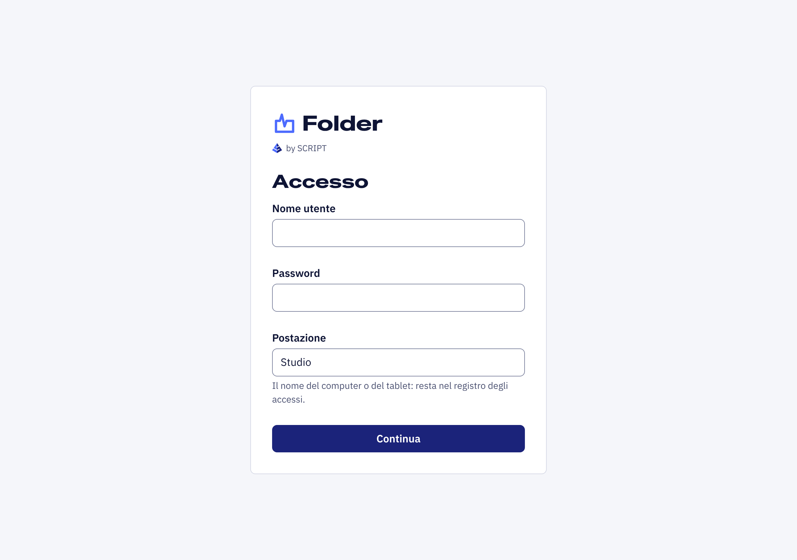
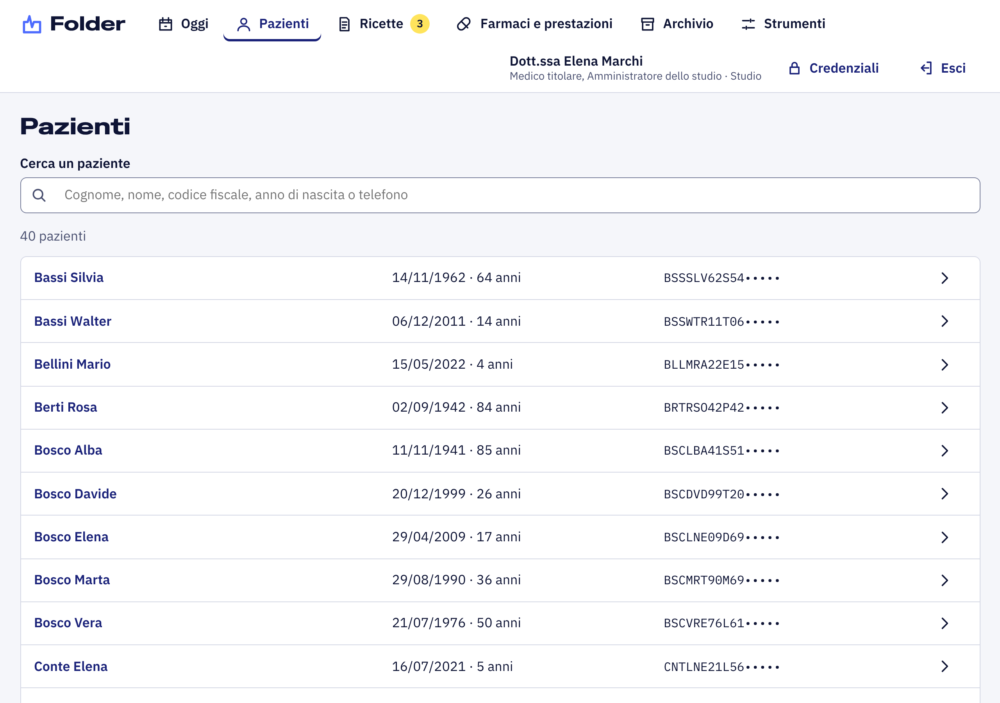
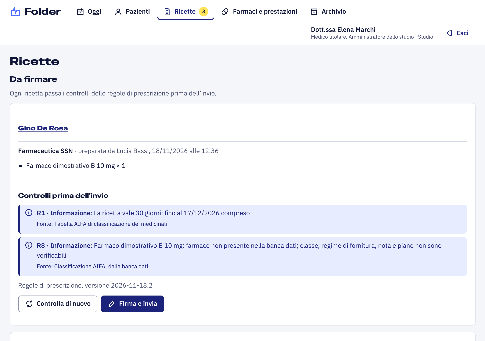
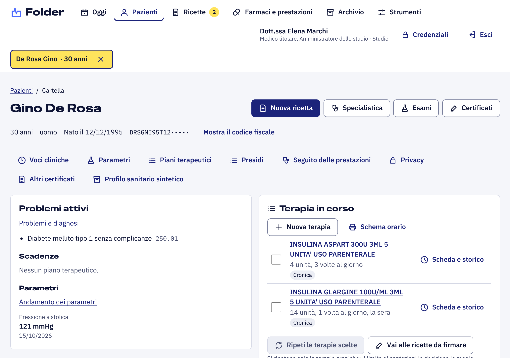
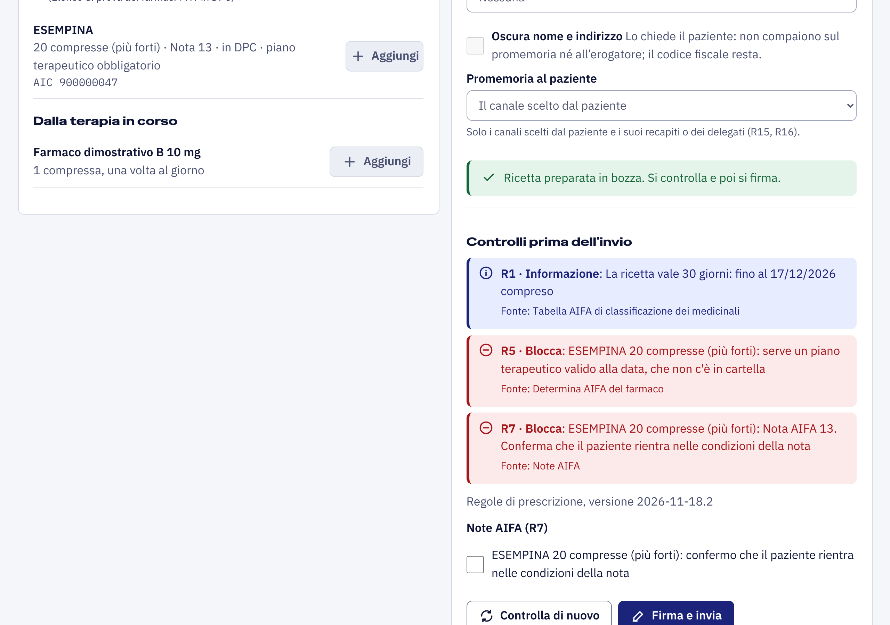
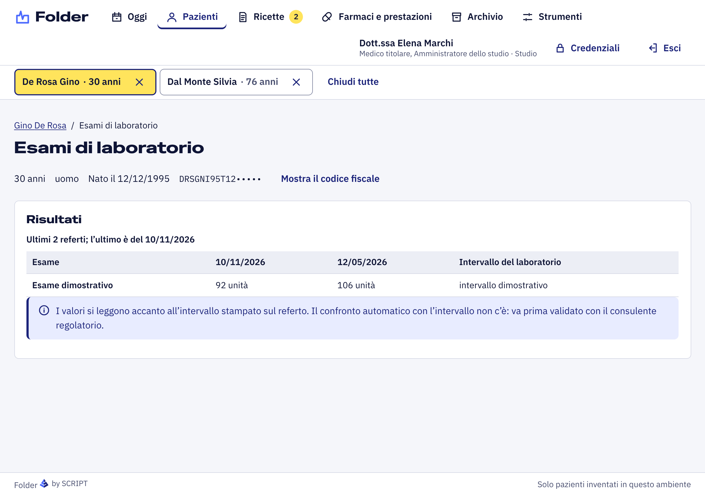
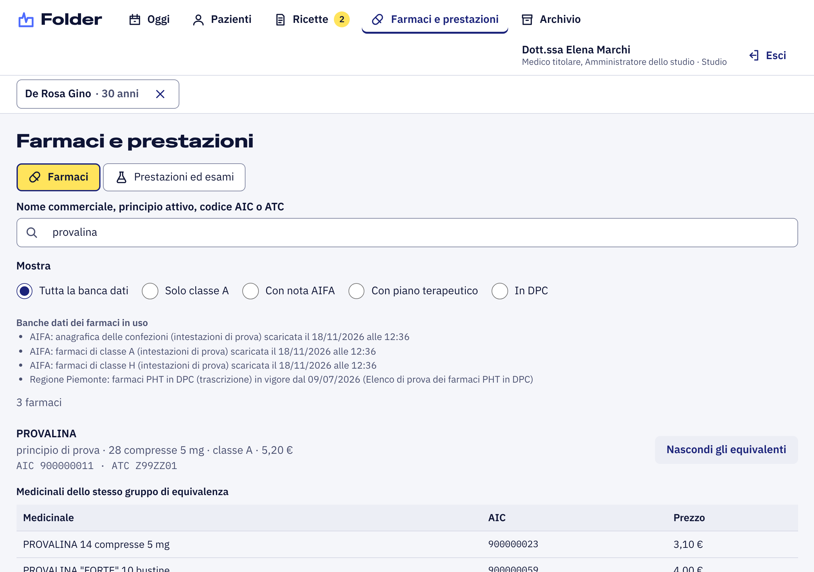
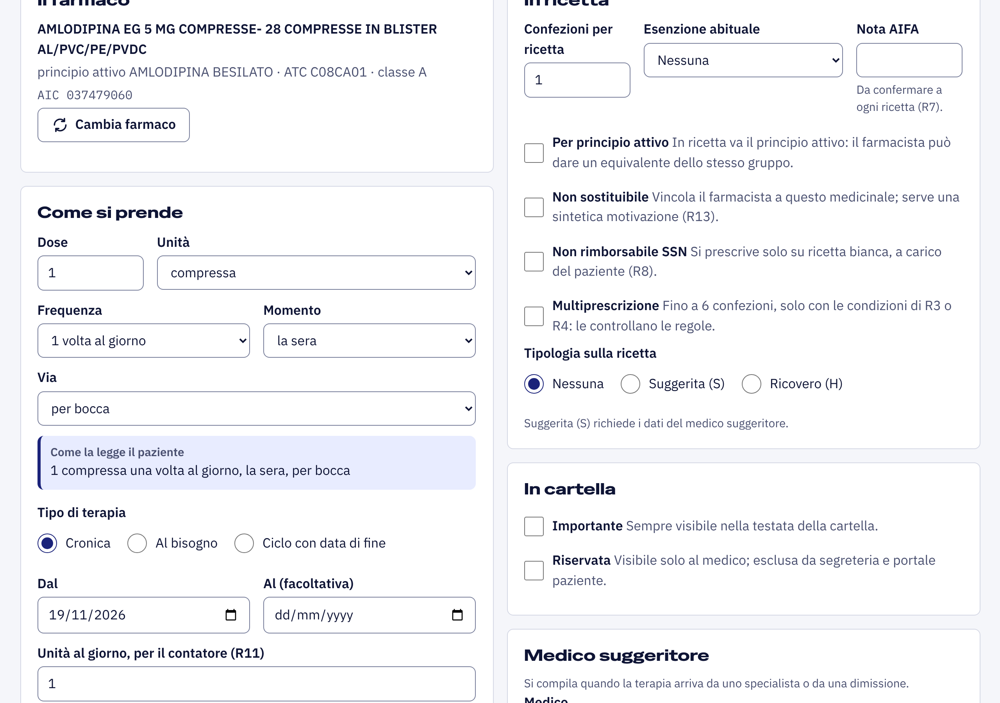
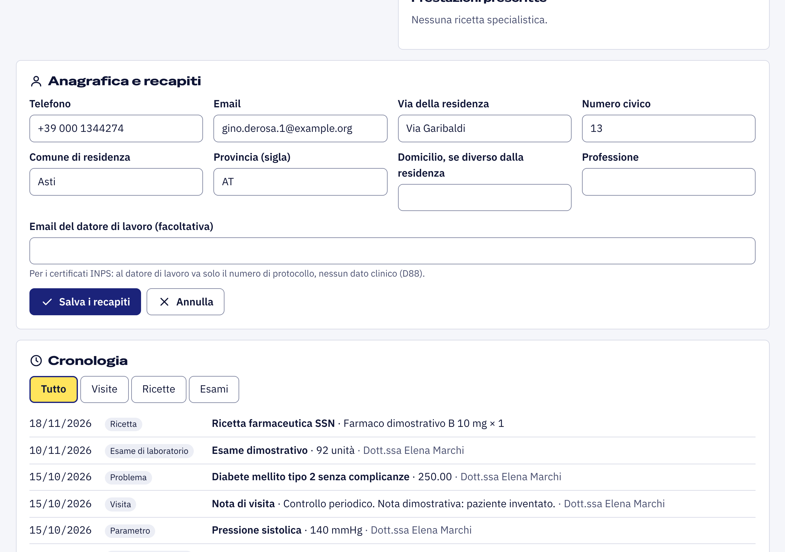
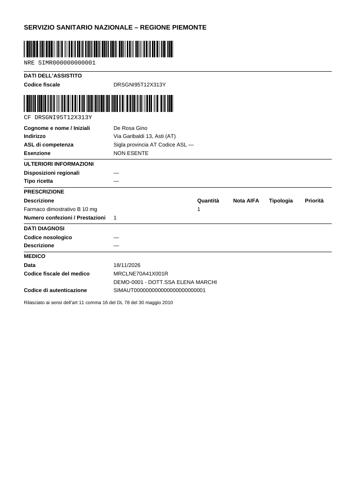

# Interfaccia per PC e tablet (tappa 6)

Le schermate della tappa 6, con i dati dimostrativi: pazienti inventati e banche dati d'esempio. Per provarle:

```sh
pnpm db:seed                               # dati dimostrativi; stampa una volta le password
pnpm banche-dati:importa -- --esempio      # banche dati d'esempio
pnpm dev                                   # servizio su :3001, interfaccia su :5173
```

All'accesso si sceglie un utente del seed (`medico`, `segreteria`, `sostituto`); al primo accesso si attiva il secondo fattore con un'app di autenticazione.

## Schermate

| Schermata                                      | Che cosa guardare                                                                                                  |
| ---------------------------------------------- | ------------------------------------------------------------------------------------------------------------------ |
|                   | Accesso: nome del prodotto in evidenza, «by SCRIPT» piccolo; poi il codice a 6 cifre                               |
|                      | Oggi: appuntamenti del giorno a sinistra, cose da fare a destra (ricette da firmare, piani in scadenza secondo R5) |
|                  | Pazienti: ricerca per cognome, nome, codice fiscale, anno di nascita o telefono                                    |
|        | Ricette da firmare: le ripetizioni preparate dalla segreteria, con i controlli prima della firma                   |
|                  | Cartella: testata, problemi, scadenze, parametri, terapia con «Ripeti», prestazioni prescritte, cronologia         |
|  | Scheda della terapia in tre parti e storico delle prescrizioni (D65)                                               |
|     | Ricetta: banche dati con la data della versione (A6), controlli con fonte e rimedio                                |
|     | Ricetta specialistica dal catalogo regionale                                                                       |
|                     | Esami: valore e intervallo del referto, senza giudizio (D71)                                                       |
|    | Ricerca farmaci con filtri ed equivalenti                                                                          |
|           | La cartella su un tablet in verticale                                                                              |
|             | Nuova terapia: farmaco dalla banca dati, come si prende, come la legge il paziente, unità al giorno (D80)          |
|               | Sospensione con motivo; la reazione avversa va tra le allergie (D81)                                               |
|             | Schema orario da stampare: momento della giornata, come si prende, fino a quando (D83)                             |
|                  | Anagrafica e recapiti modificabili dalla cartella (D86)                                                            |
|                  | Archivio del titolare: che cosa vede la segreteria ed esportazione completa (D84)                                  |
|                | Promemoria dopo l’invio: PDF, solo NRE, email o SMS al paziente o a un delegato (tappa 7)                          |
|            | Il promemoria della ricetta SSN dal modello del DM 2/11/2011, con codice di autenticazione e riga piemontese (D93) |

Le schermate si rigenerano con `test/e2e/schermate.ts` (istruzioni in testa al file), su un database appena preparato con il seed.

## Come è fatta

- **Menu**: Oggi, Pazienti, Ricette (con il numero da firmare), Farmaci e prestazioni; Archivio per il medico titolare (D84). Simbolo accanto al nome, mai al suo posto (D67).
- **Cartelle aperte insieme**: fino a 20, una scheda per paziente; ogni scheda riporta all'ultima pagina vista e la ricetta in corso resta ricordata (D68).
- **Colori**: i blu di SCRIPT per struttura e informazioni; l'evidenziatore giallo per contatori, cartella attiva e selezioni; arancio bruciato per gli avvisi, rosso per errori e blocchi, verde per gli esiti (D69). Ogni messaggio ha anche simbolo e parola.
- **Ricette**: la segreteria prepara e manda alla firma; il medico controlla, conferma le note, scrive i motivi e firma. Se l'ente non risponde, la ricetta rossa; se l'esito è incerto, niente ricetta rossa finché non è chiaro.
- **Storico** di ogni farmaco e prestazione: confezioni degli ultimi 12 mesi, autori, controlli, passaggi con l'ente; annullamento solo se l'ente non ha ancora lavorato la ricetta, e le annullate restano (D70).
- **Terapia**: nuova, modifica, sospensione con motivo (la reazione avversa va tra le allergie), ripresa, schema orario da stampare (D80–D83). I controlli formali si vedono prima di salvare, vicino al campo, e il servizio li ripete.
- **Promemoria** (tappa 7): dopo l’invio, nell’editor, nella coda delle ricette e nello storico. La ricetta bianca consegna solo il PDF del SAC (D93).
- **Accesso**: password e secondo fattore; dopo 5 minuti senza attività la sessione si blocca e si sblocca con il codice. All'uscita il browser non conserva dati dei pazienti.

## Accessibilità (WCAG 2.2 AA)

La prova nel browser (`apps/api/test/e2e/interfaccia.test.ts`) apre ogni schermata e controlla:

- nessuna violazione WCAG 2.2 A e AA trovata da axe-core;
- ogni pulsante, collegamento e campo misura almeno 44×44 px; le caselle con la loro etichetta;
- su tablet, in verticale (768×1024) e in orizzontale (1024×768), la pagina non scorre di lato;
- contrasti dei colori calcolati da una prova del marchio (testo almeno 4,5:1, elementi grafici almeno 3:1).

Le pagine hanno il salto al contenuto, titoli in ordine, etichette per ogni campo, annunci per i risultati che cambiano e il fuoco sempre visibile.

## Che cosa non c'è ancora

- Agenda e prenotazione (proposta: da Ready!), riepiloghi, certificati INPS, diario e voci cliniche nuove (allergie, problemi, piani terapeutici dall'interfaccia), presidi, seguito delle prestazioni (esecuzione, struttura, esito, referto).
- Collegamento alla segnalazione di farmacovigilanza: da completare (D82).
- Stampa del promemoria e della ricetta rossa nel modulo conforme: da completare con le specifiche.
- Tema scuro.

## Che cosa non è stato provato

- Con lettori di schermo veri (NVDA, VoiceOver): solo le regole automatiche di axe e la struttura.
- Su tablet veri: solo le misure dello schermo in Chromium.
- Con la Dr.ssa Rocca: le schermate vanno viste con lei.
