# Logo di Folder: proposte

Il segno di oggi, nei prototipi, è un tratto di ECG accanto al nome: nasce da quando il prodotto si chiamava Polso. Qui ci sono tre proposte per portarlo verso l'idea di cartella, tenendo il carattere del segno: linea continua, spessore costante, estremi arrotondati e il ritmo piatto–su–giù–piatto.

**Scelta: B, linguetta a picco** (Simone, prima fermata, 18/11/2026). È nell'interfaccia; i file definitivi sono in `packages/brand/assets/logo/` (segno, segno su scuro, con il nome, con il nome su scuro, favicon).

## Confronto alla stessa misura

In ogni riga: segno di oggi, A, B, C. Sopra su fondo chiaro, sotto su fondo scuro.

**16 px** (la misura dell'icona nella scheda del browser)

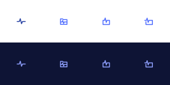

**32 px**

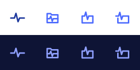

## Segno di oggi

Per riferimento, nel blu `#1F3A9E` dei prototipi. Ogni tavola mostra il segno a 16, 32 e 64 px e poi il segno con il nome.

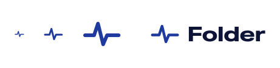
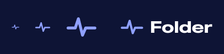

## A · Battito sulla cartella

La sagoma della cartella con la linguetta, e il battito che la attraversa da un lato all'altro. Due tratti, ognuno continuo.

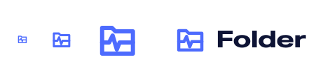
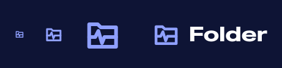

## B · Linguetta a picco (consigliata)

Una sola linea chiusa: la linguetta della cartella è il picco del battito, e la discesa entra nella cartella.

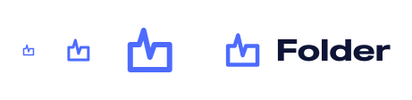
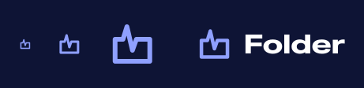

## C · Tratto che diventa cartella

Il battito entra da sinistra come nel segno di oggi, poi prosegue e disegna la cartella. Una sola linea aperta.

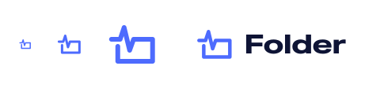
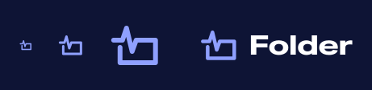

## Valutazione

Le valutazioni vengono da rendering in Chromium alle misure reali (non solo dal disegno ingrandito).

| Proposta | 16 px                                                              | 32 px     | Fondo chiaro e scuro | Note                                                       |
| -------- | ------------------------------------------------------------------ | --------- | -------------------- | ---------------------------------------------------------- |
| A        | Si impasta: linguetta, bordo e battito sono troppi segni per 16 px | Leggibile | Sì                   | La più letterale; regge da circa 24 px in su               |
| B        | Leggibile: sagoma compatta, picco riconoscibile                    | Leggibile | Sì                   | Una linea sola, chiusa: funziona anche come icona dell'app |
| C        | Leggibile, ma l'apertura a sinistra si nota poco                   | Leggibile | Sì                   | La più vicina al segno di oggi: chi lo conosce lo ritrova  |

**Consiglio la B.** È l'unica che resta una cartella riconoscibile anche a 16 px, ha una sagoma piena che funziona come icona e tiene il battito in un solo gesto. Se invece conta di più la continuità con il segno di oggi, la C è l'alternativa.

## Colori

Proposte nella tavolozza di SCRIPT: segno in luce `#4D6BFE` e nome in testo `#0E1435` su fondo chiaro; segno in `#8FA0FF` e nome in bianco su fondo scuro. Il motivo: Folder si presenta come prodotto di SCRIPT, e il blu `#1F3A9E` dei prototipi era un segnaposto. Il contrasto del segno è sopra 3:1, come chiede WCAG per gli elementi grafici: 4,33:1 su bianco e 7,38:1 sul fondo scuro di SCRIPT (calcolati con `contrastRatio` di `packages/brand/tokens.ts`). La scelta è la decisione D13 in `docs/decisioni.md`.

## File

In `packages/brand/assets/proposte-logo/`, per ogni proposta:

- `proposta-X-segno.svg` e `proposta-X-segno-su-scuro.svg`: il solo segno;
- `proposta-X-con-nome.svg` e `proposta-X-con-nome-su-scuro.svg`: segno e nome, con il nome in Special Gothic Expanded One convertito in tracciati (nessun testo nel file);
- `tavole/`: le tavole di confronto di questa pagina.

C'è anche `segno-attuale.svg`, il segno di oggi identico all'originale.

Il simbolo di SCRIPT non entra in nessuna proposta: nell'interfaccia resta separato, accanto a «by SCRIPT».

Tutto è generato da `packages/brand/scripts/genera-proposte-logo.ts` (`pnpm --filter @mmg/brand logo:proposte`), con il nome preso da `packages/brand/brand.ts`. Una prova controlla che gli SVG non abbiano testo, sfumature o filtri, che gli estremi siano arrotondati e che i colori siano quelli ammessi.

## Su fondo scuro (D214)

Dopo la scelta, su fondo scuro il segno diventa un'icona gialla (`#FFE45C`, il giallo dell'evidenziatore dell'interfaccia) con il segno blu scuro (`#1B237A`, l'ombra di SCRIPT); il nome resta bianco. Sul chiaro resta il segno blu. Il giallo da solo non va: sul bianco ha un contrasto di circa 1,3:1. Come fondo, sotto il blu scuro, è circa 10:1, e l'icona sul blu notte di SCRIPT circa 14:1.

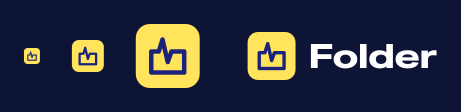

La favicon segue il tema del browser: segno blu nel tema chiaro, icona gialla nel tema scuro.

## Dopo la scelta

1. Fatto: `packages/brand/mark.ts` usa la geometria della B (da `logo-proposals.ts`) e il componente `Logo` dell'interfaccia la disegna, con il nome da `PRODUCT_NAME`.
2. Fatto: favicon dell'interfaccia (`apps/web/public/favicon.svg`) generata dal segno. L'icona dell'app per tablet arriva con l'interfaccia (tappa 6).
3. Le proposte scartate e il segno di oggi restano qui come traccia.
